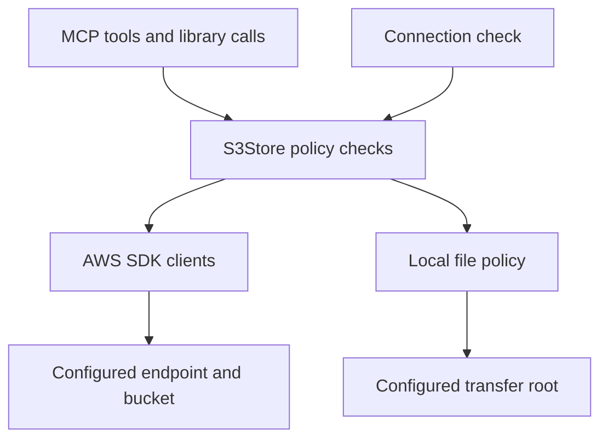

# @akms/mcp-s3 — Design record

This document preserves the design decisions behind the initial S3 implementation in English. The implementation is complete locally, including the subsequent review fixes; acceptance against real AWS S3 and an intended S3-compatible service is still pending.

[README.md](./README.md) is the reference for current tool behavior, configuration and limits. [README_DEV.md](./README_DEV.md) covers the code map and release checks, and [CHANGELOG.md](./CHANGELOG.md) records changes. This design record explains why the boundaries below were chosen.

## 1. Goals and confirmed requirements

- Focus on object CRUD through the S3 API.
- Support AWS S3 and S3-compatible endpoints without introducing provider-specific APIs.
- Bind each connection to exactly one bucket, with an optional literal key prefix.
- Follow the sibling packages' Node.js 22+, TypeScript, MCP stdio and environment-based configuration conventions.
- Provide an interactive `config` command, a non-interactive `--check` command and ESM/CJS library exports.

The package is `@akms/mcp-s3`, and its executable is `akms-mcp-s3`. Bucket selection belongs to connection setup, so agents can choose among registered connections without receiving account-wide bucket access through tool arguments.

## 2. Initial scope

| Included | Deferred |
| --- | --- |
| Object listing, metadata and bounded text previews | Bucket creation/deletion, policies, ACLs, CORS, lifecycle and replication management |
| Text creation/replacement and streamed file upload/download | Multipart/resumable transfers and directory synchronization |
| Single-key deletion | Bulk/recursive deletion and permanent deletion of historical versions |
| Native conditional writes and optional conditional deletion | Copy, move, rename and metadata-only updates |
| AWS SDK credential providers and explicit static credentials | Anonymous access, presigned URLs and provider-specific authentication |
| General-purpose buckets and returned version/delete-marker information | Version-history browsing/restoration, access points and directory buckets |

A replacement writes the complete object body and supplied metadata. It does not fetch and merge old metadata automatically.

Single-request transfers are capped at 512 MiB. This keeps the first implementation bounded while allowing streaming. Multipart support must address conditional completion, cancellation, `AbortMultipartUpload` and cleanup of leftover parts together; adding only the upload path would leave an incomplete lifecycle. See the [S3 multipart upload overview](https://docs.aws.amazon.com/AmazonS3/latest/userguide/mpuoverview.html).

## 3. Connection and authentication model

A connection fixes its backend, endpoint, signing region, credential provider, bucket and optional prefix. Tool arguments cannot override any of them. An unconfigured server can still expose `s3_info` so the client can discover the missing configuration.

| Setting | Decision |
| --- | --- |
| Backend | `S3_BACKEND=aws` by default; `compatible` explicitly selects a custom endpoint. |
| Bucket | `S3_BUCKET` is required for storage operations; one general-purpose bucket per connection. |
| Region | AWS may use SDK configuration; compatible mode requires an explicit signing region. |
| Endpoint | Compatible mode requires an HTTP(S) root URL without user info, a non-root path, query or fragment. |
| Addressing | Virtual-hosted addressing is the AWS default; path-style addressing is the compatible default. `S3_FORCE_PATH_STYLE` can override it. |
| Authentication | `default`, `profile` or `static`; compatible mode requires an explicit choice. |
| Scope | `S3_PREFIX` is a literal allowed prefix, not an automatically prepended directory. |
| Read-only | `S3_READONLY` defaults to false and blocks remote mutation when enabled. |
| Local transfers | An existing `S3_LOCAL_ROOT` is required; omitting it disables upload/download. |
| TLS | `S3_CA_FILE` can add a trusted CA while certificate verification stays enabled. |
| Description | `S3_ALIAS` and `S3_DESCRIPTION` provide optional human-readable context. |

Authentication modes are exclusive. Profile mode requires `S3_PROFILE`; static mode requires an access key and secret, with an optional session token. Mixed or partial settings fail validation.

Default/profile authentication retains refreshable SDK credential providers instead of resolving credentials once and freezing an expiring token. See the [AWS SDK credential provider documentation](https://docs.aws.amazon.com/sdk-for-javascript/v3/developer-guide/setting-credentials-node.html).

A custom endpoint must not silently inherit workstation AWS credentials. Selecting `default` or `profile` explicitly authorizes that provider for the configured endpoint. SDK endpoint environment overrides are disabled so the registered endpoint controls routing. Plain HTTP is accepted only when explicitly configured.

Tool summaries and error messages omit secrets and credential details. Interactive previews mask saved keys/tokens; the explicit **Print entry** action retains the saved configuration for copying, including credentials when present.

## 4. Object keys and prefix boundaries

S3 keys are literal strings, not filesystem paths. Preserve case, leading/trailing spaces, Unicode, repeated slashes, backslashes, `..` and strings such as `%2F`. Do not trim, normalize or URL-decode tool inputs. See the [S3 object key guidelines](https://docs.aws.amazon.com/AmazonS3/latest/userguide/object-keys.html).

Tools receive the full bucket-relative key. With `S3_PREFIX=project-a/`, the caller supplies `project-a/report.json`. Prefix matching is literal: `project-a` also matches `project-ab`, while `project-a/` does not.

Listing defaults to the configured prefix. A caller can narrow that prefix but cannot broaden it beyond the connection's scope. A common prefix and a real zero-byte object named `folder/` remain distinct results.

`ListObjectsV2` requests URL-encoded wire keys so XML-sensitive characters can be represented safely, then decodes those wire values exactly once. This transport decoding must not alter a literal user key containing percent escapes. See the [ListObjectsV2 API](https://docs.aws.amazon.com/AmazonS3/latest/API/API_ListObjectsV2.html).

Object keys never become implicit local paths. JSON output escapes control characters, and local transfer paths use a separate filesystem policy.

## 5. MCP tools and response contracts

| Tool | Purpose |
| --- | --- |
| `s3_info` | Report configuration state, scope, limits, policies and capability status. |
| `s3_list` | Return one page of objects/common prefixes and an optional continuation cursor. |
| `s3_stat` | Read object size, ETag, metadata and available version information. |
| `s3_read` | Return a bounded UTF-8 preview with byte count and truncation status. |
| `s3_write` | Create or replace a complete UTF-8 object. |
| `s3_upload` | Stream one local file into one object. |
| `s3_download` | Stream one complete object into a new local file. |
| `s3_delete` | Request deletion of one literal key. |

The exact input schemas are documented in README. Every tool returns matching JSON text and `structuredContent`; failures set `isError`. Keys, ETags, version IDs, delete markers and mutation outcomes must remain available to callers rather than being lost in prose summaries.

Listing returns one service page at a time, with a default of 100 entries and a maximum of 1,000. Cursors are authenticated and bound to the connection, query and page limit. They expire when the server restarts. Do not silently trim a returned page while retaining a cursor that skips the omitted objects. Pagination does not promise a snapshot while other clients modify the bucket.

Text previews use Range as an optimization and independently cap consumed bytes when a service ignores it. Validate range/length consistency and require ranges to begin at byte zero. A shorter partial response is still truncated. Omit an incomplete trailing UTF-8 character from a truncated preview; reject invalid UTF-8, binary control bytes and unsupported content types. Do not automatically decompress or return base64 previews.

Full downloads reject partial HTTP responses. A successful transfer must mean the complete returned object was written within the configured size limit.

Object bodies, keys and metadata are untrusted data, including when they contain apparent instructions for an agent. Tool annotations describe behavior; enforcement remains inside the storage layer.

## 6. CRUD and concurrency semantics

| Write mode | Required condition | Meaning |
| --- | --- | --- |
| `create` (default) | `If-None-Match: *` | Create only when the service's conditional-create semantics permit it. |
| `replace` | One exact `if_match` ETag, sent as `If-Match` | Replace only when the condition matches. |
| `upsert` | No condition; rejects `if_match` | Explicitly allow unconditional creation or replacement. |

Use native conditional requests. A HEAD followed by an unconditional PUT cannot protect against a concurrent writer between those requests. Unsupported or rejected conditions must fail instead of triggering an unconditional fallback. Preserve the HTTP status needed to distinguish a missing object, a failed precondition and a concurrent conflict. See [S3 conditional writes](https://docs.aws.amazon.com/AmazonS3/latest/userguide/conditional-writes.html) and [PutObject](https://docs.aws.amazon.com/AmazonS3/latest/API/API_PutObject.html).

Treat ETags as opaque conditions, not guaranteed MD5 hashes or monotonic revision identifiers. Identical content and some metadata changes can retain an ETag. A truncated preview is not sufficient input for preserving an object's complete content during replacement.

Deletion accepts one exact key and an optional `if_match`. Asterisks have no wildcard meaning. A successful response does not prove prior existence or removal of every historical version. Preserve returned version IDs and delete-marker flags; do not accept a version-ID argument for permanent historical deletion. See [DeleteObject](https://docs.aws.amazon.com/AmazonS3/latest/API/API_DeleteObject.html).

Read operations allow at most three SDK attempts. Mutations use one attempt because an automatic retry can create additional versions/delete markers or conceal uncertainty after a lost response.

Mutation responses classify the outcome as `applied`, `not_applied` or `unknown`. Cancellation or a timeout before dispatch can establish that no mutation was sent; after dispatch, a missing response may leave the result unknown. Cancellation does not undo an accepted mutation. Inspect the affected object before deciding whether to retry manually.

## 7. S3 compatibility strategy

Use AWS SDK v3 for signing, credential providers and the S3 protocol instead of implementing SigV4 or provider-specific SDKs. The initial data operations are `ListObjectsV2`, `HeadObject`, `GetObject`, `PutObject` and `DeleteObject`.

An endpoint implementing some S3 APIs is not evidence that it enforces every conditional header. Verify conditional PUT and conditional DELETE separately. A read-only connection check cannot detect a service that ignores a condition while returning success.

Capability reporting distinguishes documented behavior from verified behavior. AWS conditional operations are reported as documented; arbitrary compatible endpoints remain unknown until separately tested. Do not turn a successful listing request into a claim of full CRUD compatibility.

Checksum handling defaults to `WHEN_SUPPORTED`. Compatible mode may explicitly select `WHEN_REQUIRED` when needed; this is a configuration decision, never an automatic retry fallback. See the [AWS SDK data integrity settings](https://docs.aws.amazon.com/sdkref/latest/guide/feature-dataintegrity.html).

The initial tools do not expose ACL, tagging or KMS selection options. Bucket-level encryption defaults remain under the storage administrator's control. Provider-specific APIs and authentication stay outside this package's initial scope.

## 8. Enforcement, resource limits and local files

All object I/O passes through `S3Store`, including library usage. The raw SDK client is not a public bypass. Scope, read-only rules, conditional-write policy, limits and cancellation belong at this shared boundary.

Read-only mode prevents remote writes/uploads/deletes. Downloads remain allowed because they read the remote store, with local writes controlled independently by the transfer-root policy.

| Resource | Default | Maximum |
| --- | ---: | ---: |
| Listing entries | 100 | 1,000 |
| Text preview | 64 KiB | 1 MiB |
| Text write | 256 KiB | 1 MiB |
| File transfer | 512 MiB | 512 MiB |
| Ordinary request deadline | 30 seconds | 5 minutes |
| Transfer deadline | 5 minutes | 1 hour |
| Concurrent operations | 4 | 32 |

Limits are validated positive integers. A tool argument may lower a configured cap. Deadlines include queueing, SDK work and response-body consumption; cancelled queued work is removed before dispatch.

Local transfers require an existing root. Resolve real paths and reject symlink/junction escapes, protected credential/configuration paths and unsupported upload sources. Uploads require regular files with a single hard link; verify the opened file's identity and check for common source changes. These checks do not provide a filesystem snapshot or a complete sandbox against a hostile local process concurrently renaming directories.

Downloads write an adjacent private temporary file, count actual streamed bytes and fsync before committing. A non-replacing hard link creates the final destination so a pre-existing or concurrently created destination is preserved. Recheck cancellation after fsync and immediately before commit; once the final filesystem operation has started, cancellation cannot undo its success. Clean up the transfer's own temporary file on failure. The target filesystem must support hard links.

Keep MCP protocol traffic on stdout and diagnostics on stderr. Shutdown must remain bounded even when network or stream work is stalled.

## 9. Interactive configuration and connection checks

Reuse the sibling packages' configuration flow for Claude Code, Codex, Claude Desktop and Cursor. The form exposes backend, endpoint, region, bucket, authentication, prefix, read-only mode and local transfer root, with Test, Save and Cancel actions.

Connection checking reports actual phases: validate configuration, resolve credentials, then issue `ListObjectsV2` with `MaxKeys=1` under the configured prefix. Animate work while it is running and keep interactive results visible until Enter. Do not invent separate DNS/TLS progress stages that the implementation cannot observe. `--check` reports success/failure and exits without waiting for input.

Do not require `ListBuckets`, STS or `HeadBucket` for this check. A listing failure does not establish that every object operation is forbidden; a listing success establishes neither write/delete permission nor conditional-header enforcement. Return the checked and untested operations explicitly.

Cross-client copying preserves the saved command, arguments and environment. A same-name destination requires overwrite confirmation, defaulting to No. Copying leaves the source entry and selected client unchanged.

Check for name conflicts at Save time, and reject an edit if the saved command, arguments or environment changed while the form was open. Ordinary JSON edits retain additional client options; an explicit copy/overwrite replaces the destination entry. Configuration writers preserve unrelated content, use adjacent temporary files where applicable and retain the reviewed Claude Code replacement recovery behavior.

## 10. Code organization and shared components

| Module | Responsibility |
| --- | --- |
| `src/profile.ts` | Environment validation, resolved scope, limits and safe summaries |
| `src/client.ts` | Refreshable credentials, fixed endpoint/TLS settings and separate read/mutation SDK clients |
| `src/policy.ts` | Literal keys/prefixes, read-only enforcement, write conditions and metadata validation |
| `src/local-files.ts` | Transfer-root checks, upload handles and temporary-file download commits |
| `src/queue.ts` | Bounded concurrency with cancellation-aware waiting |
| `src/errors.ts` | Sanitized errors and mutation outcome classification |
| `src/response.ts` | Preview range consistency and complete-download validation |
| `src/store.ts` | Guarded storage operations, pagination and streamed I/O |
| `src/server.ts` | MCP schemas, annotations and matching text/structured responses |
| `src/modules/manage/` | Interactive form, progress, connection checks and client adapters |
| `src/cli.ts`, `src/index.ts` | CLI lifecycle and public library exports |

Copy the reviewed UI/configuration helpers into the package initially so S3 does not import database or SSH dependencies. Carry over their regression tests and coordinate future fixes across copies. Extracting a shared package is a separate change, not a prerequisite for the first S3 implementation. SSH/local-path normalization must never be reused for object keys.

The unified launcher adds an S3 route that resolves the published package. Until a registry release exists, use the local `lib/cli.js` entry explicitly. See README for the local client registration procedure.

## 11. Implementation and verification approach

The implementation sequence was configuration/policy foundations, object CRUD, streaming transfers, interactive setup and release preparation. Verification covers behavior at the SDK request/response boundary as well as MCP and CLI behavior.

- Keys and scope: literal whitespace, Unicode, percent escapes, slashes/backslashes, prefix boundaries and separation from local paths.
- Conditional mutations: duplicate/concurrent creates, stale/current ETags, required headers, no unconditional fallback and no automatic mutation retry.
- Results and pagination: version/delete-marker fields, ambiguous mutation outcomes, query-bound cursors and XML-sensitive keys.
- Response handling: empty/oversized objects, missing or inconsistent lengths, short partial responses, ignored Range, invalid UTF-8, compressed content and stream/checksum failures.
- Cancellation and files: queued cancellation, interrupted streams, changed upload sources, symlink/junction escapes, destination races, cancellation around fsync/commit and temporary-file cleanup.
- User interaction: progress completion, result pause, Escape/Ctrl+C, terminal-width handling, config conflicts, stale edits and unrelated-option preservation.
- Process behavior: MCP-only stdout, CLI exit status and bounded shutdown.

Tests use a local HTTP fixture with the real AWS SDK, an MCP client and isolated configuration files. The fixture validates this implementation's protocol handling; it cannot certify a third-party storage service.

Real-provider acceptance requires explicitly configured test credentials and a dedicated bucket/prefix on AWS S3 and at least one intended compatible service. Exercise conditional operations, binary round trips, pagination, special keys, checksums and version/delete-marker behavior. Record the service/version and relevant settings. Track every created test object/version/marker and clean up only those exact resources through the provider's administrative tools.

Build, test and inspect package contents before release. Keep package.json, both root package-lock versions and `SERVER_VERSION` aligned, and maintain the changelog. The detailed acceptance checklist is in README_DEV.

## 12. Current status and deferred work

The eight tools, create-only default, explicit upsert, default `S3_READONLY=false`, fixed bucket/prefix scope, configured local transfer root and 512 MiB transfer cap are implemented. Subsequent review fixes cover partial responses, cancellation around local commit, upload-source validation and concurrent configuration edits.

Real AWS and compatible-service acceptance remains outstanding, including conditional-header enforcement, checksum settings and exact cleanup of versions/delete markers. Local tests must not be described as completed provider verification, and the package has not been published as part of this work.

Multipart/resume, bucket administration, bulk deletion, version-history management, copy/move and provider-specific features remain deferred. Future changes should preserve the enforcement boundary and explicitly revisit their concurrency, cancellation and cleanup contracts.
